<p align="center">
  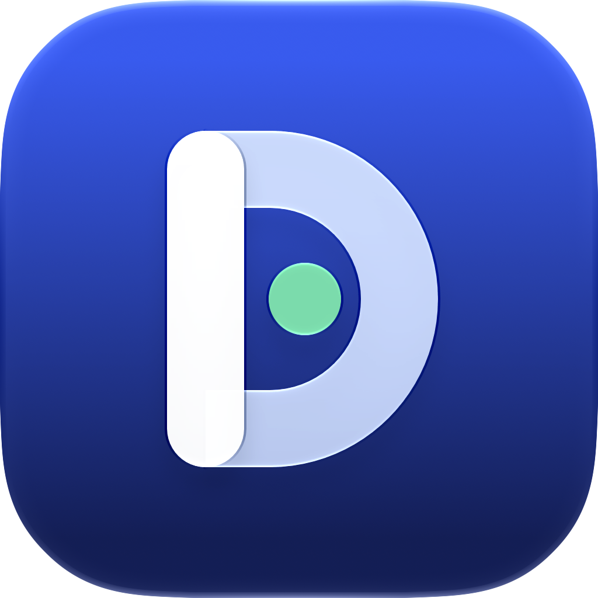
</p>

<h1 align="center">DeviceMonitor</h1>

<p align="center"><b>Who's on your Wi‑Fi, right now.</b><br>
An honest, private network monitor for iPhone, iPad and iPhone Duo, built for iOS 27 and Liquid Glass.</p>

<p align="center">
  
  
  
  
  
  
</p>

<p align="center">
  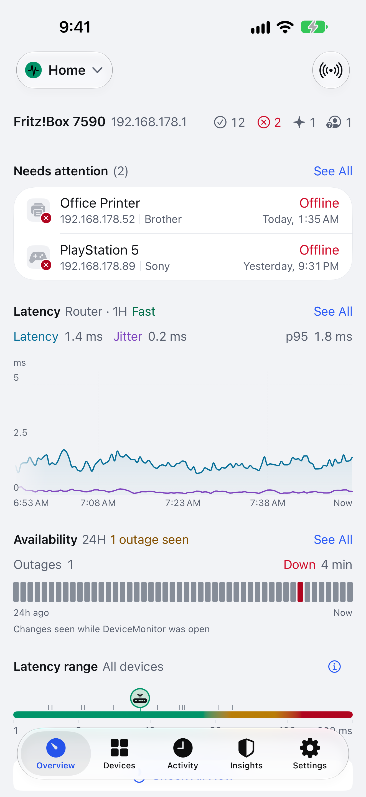
  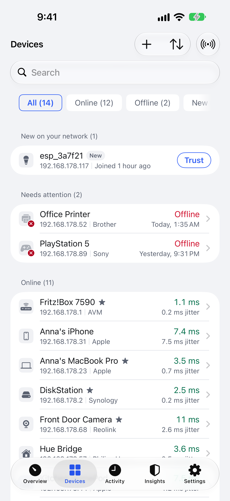
  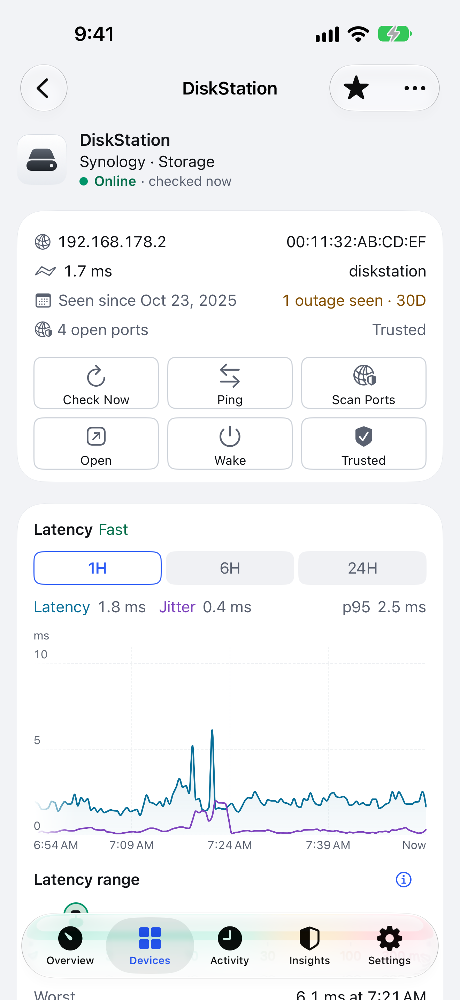
  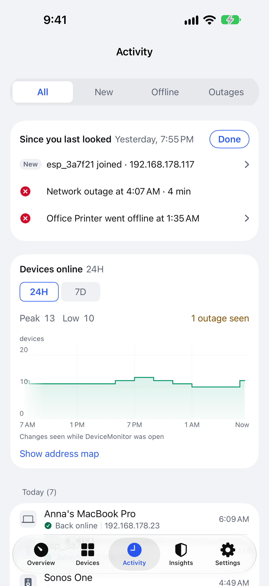
</p>
<p align="center">
  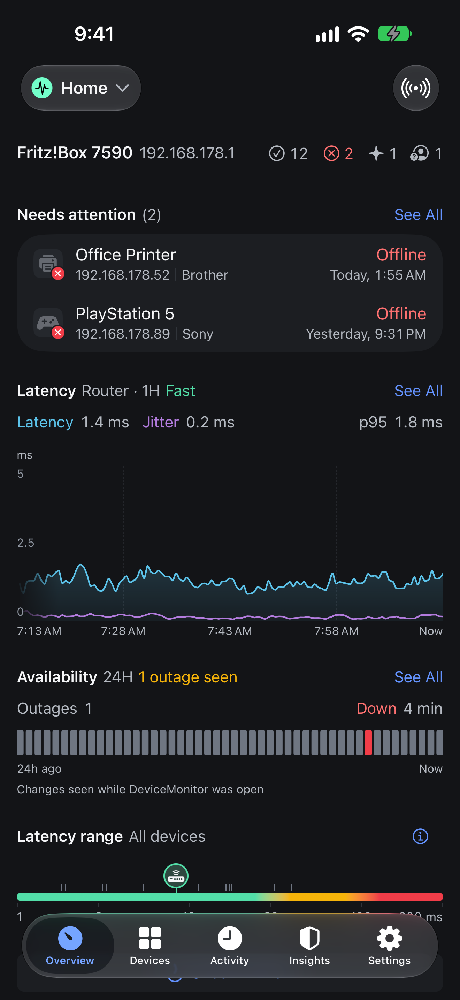
  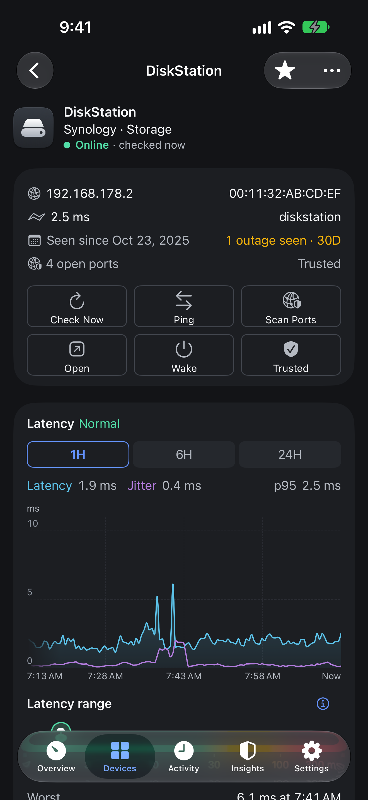
  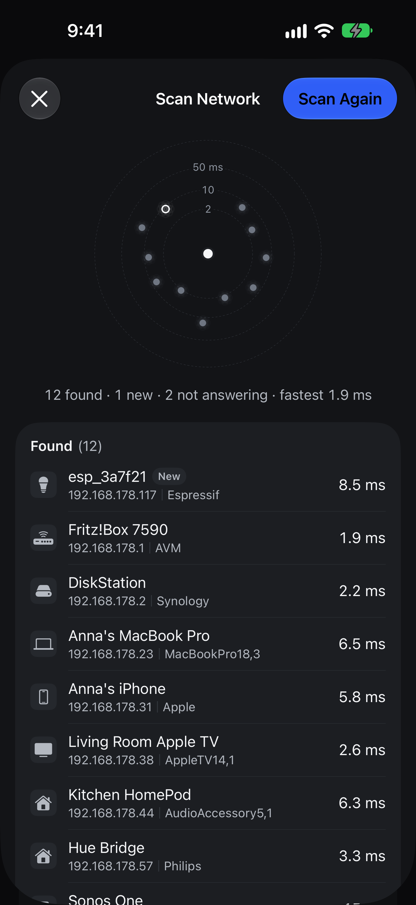
  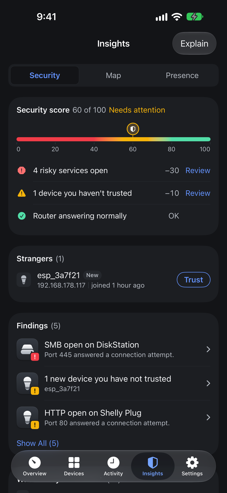
</p>

DeviceMonitor finds the routers, computers, phones, printers, speakers, cameras and smart‑home gear on your network, keeps checking whether they answer, and tells you when something changes. There is no account, no ads and no location access. Everything stays on the phone.

## Highlights

**See everything**
- Scans your subnet (up to /22) with short TCP connection attempts, with ping (ICMP) and UDP for devices that refuse connections. The Scan sheet shows a radar of ping waves and four stages while it runs, then one line such as "12 found · 1 new · 2 not answering · fastest 1.2 ms".
- Browses 28 Bonjour service types (AirPlay, HomeKit, printers, SMB, Chromecast, Sonos, Hue, Matter, SSH and more) and reads TXT records for model and vendor hints.
- Recognises 13 kinds of device from services, model identifiers (including current `MacXX,Y` Macs), hostnames, vendors and ports.
- Names devices the way you know them: the AirPlay, Cast or Bonjour name first, then the hostname. A nickname you give always wins, and a device you add by hand keeps the name you typed.
- Keeps one identity per device across IP changes (MAC, hostname, Bonjour name, address), so nicknames, notes, tags and trust are never lost. AirPlay names that carry a MAC (`<MAC>@Living Room`) merge with the device's other services and enable Wake‑on‑LAN.

**Honest status**
- A device turns *Unstable* on a missed check and *Offline* only after the number of misses you choose; it needs repeated answers to come back. One dropped packet is never an alarm.
- Adaptive scheduling: unstable devices are checked more often, long‑offline ones back off, a device that answers again is confirmed quickly, and the router always goes first.
- Probes cut short by a pause or refresh are ignored, so backgrounding the app never invents an outage.
- History counts the outages the app saw while it was open ("1 outage seen") and never shows a percentage over a span, because iOS does not let it watch the network while it is closed.

**Understand it**
- **Overview**: the first screen answers "is my network OK, and what needs me?" The router's line carries counters for online, offline, new and stranger devices, and each opens the device list with the same filter. Below it: the devices that need attention, the router's latency and jitter over the last hour, a 24‑hour availability strip with the outages it saw, where your devices' median latency sits on a range from 1 to 300 ms, Check All Now, and shortcuts to outages, Add Device, the map, presence and export.
- **Devices**: a search field that finds devices by name, address, hostname, vendor, kind, MAC or tag, and one row of filter chips with counts: All, Online, Offline, New, Strangers and Favorites. New devices get their own section with an inline Trust, every row shows its latency over its jitter, and sorting by latency uses buckets, so jitter never reorders rows.
- **Device pages**: a header with the device's state, an info grid (address, MAC, latency, hostname, first seen, outages seen, open ports and trust) and up to six action tiles. The **Latency** card covers the last hour, 6 hours or 24 hours: median, jitter and p95 in one line that doubles as the legend, a chart you can scrub, the device's place on the latency range, and its worst sample, spikes and measured time, with gaps left as gaps. Availability strips cover 24 hours, 30 and 90 days; open services come with plain‑language advice, then Bonjour services and a connection log.
- **Activity**: what changed since you last looked, a chart of devices online over 24 hours or 7 days that you can scrub to filter the feed, the address map, and a feed of arrivals, departures and outages, with mass drop‑outs collapsed into one entry.
- **Insights**, in three sections. **Security**: a 0–100 score on a gradient scale, with a checklist that says what to fix and what each item costs (your router's own DNS and admin page never count against you), a **Strangers** list with one‑tap Trust, findings that link to the device, and the mix of device kinds. **Map**: the network grouped by kind with rings at 2, 10 and 50 ms. **Presence**: who was online in each hour of the day.
- **Apple Intelligence**: on supported iPhones, plain‑language explanations written on‑device. Device names from the network are fenced as data so they cannot steer the model.

**Act on it**
- Up to six action tiles on a device page: Check Now; a five‑probe **Ping** with loss and min / avg / max; Scan Ports; Open for the device's web interface, SSH or screen sharing (VNC); Wake (Wake‑on‑LAN, a unicast magic packet, for a device with a known MAC); and Trust.
- Favourites, trust, tags, notes, nicknames and kind overrides; CSV and JSON export (CSV is hardened against spreadsheet formula injection).
- Keyboard commands on iPad: Scan Network ⌘R, Check All Now ⇧⌘R, Pause or Resume ⌥⌘P, Add Device ⌘N, ⌘1–⌘5 for the five tabs and ⌘F for Find Device.
- Siri and Shortcuts: "Scan my network with DeviceMonitor" and "How is my network in DeviceMonitor".

## Design

- **Ping, the brand**: the icon is a **D** whose bowl is a signal and whose dot is a device answering: a white stem, a pale cobalt bowl and a mint dot on a cobalt gradient. It is a layered Icon Composer `.icon` with light, dark, tinted and clear appearances. Inside the app the mark appears three times only: on Welcome, in the Settings header and in the empty device list.
- **A calm, dense network instrument**: graphite surfaces with a faint cobalt cast, short sentence‑case titles, and the evidence drawn with thin lines, dashed hairlines and quiet gradients. Dark is the hero appearance; light mode is the same design on a cool paper grey. Ten rules hold every screen together:
  1. **Colour means one thing.** Cobalt is what you can touch or what is selected. Mint, amber and red say how a device is doing, always beside a word or a symbol. Cyan is the latency series and violet the jitter series. Everything else is graphite: no colour per kind of device, no tinted backgrounds apart from Welcome.
  2. **Glass is the control layer.** Liquid Glass floats only above the content: the tab bar, toolbars and their items, the network menu, the search fields, the tab accessory and the error toast. Cards, rows, chips, charts, the radar and the maps are opaque and flat.
  3. **Selection is an outline or a well, never a filled block.** A selected chip or pill has a cobalt outline, a selected segment sits in a well with a semibold label. Only two buttons in the app are filled: Scan Again and Continue on Welcome.
  4. **Density with alignment.** One 16‑pt margin (20 pt from 600 pt wide), 16‑pt card padding, 20‑pt gaps, 56‑pt device rows and 44‑pt settings rows, with values in a right‑aligned column.
  5. **Hierarchy by weight and grey, not size.** Bold titles with a grey qualifier ("Latency · Router · 1H"), no uppercase eyebrows, no rounded font and no giant numbers; live numbers use monospaced digits.
  6. **Honest data.** Only what an iPhone can measure: reachability, latency and jitter, outages, ports and services, vendor, kind and presence. Never traffic or Wi‑Fi signal. Time windows are the ones the history can fill, gaps stay gaps, and history counts the outages seen while the app was open.
  7. **Charts with little ink.** Crisp 1.5‑pt lines, a soft gradient under the main series only, three dashed gridlines with their values inside the plot and "Now" as the last label. There is no legend box: the coloured words of the summary line are the legend. VoiceOver reads each chart as one element and offers its Audio Graph.
  8. **iOS conventions first.** Labelled tabs, Dynamic Type on every text, 44‑pt hit areas and verbs on buttons. Text reaches 4.5:1 (7:1 with Increase Contrast) and status marks 3:1, and a unit test guards the tokens.
  9. **Motion means a ping.** An arc ripple goes out from the mark on Welcome and ping waves cross the radar while a scan runs; a breathing dot means monitoring is live; numbers roll, symbols morph and the selected segment slides. Nothing else loops, and every motion has a still version for Reduce Motion and "Reduce visual effects".
  10. **Evidence is part of the product.** Screenshots come from the current build and only after a screen‑specific identifier appears, and flow tests drive every main feature on iPhone and iPad.
- **Drawn, not decorated**: Swift Charts draws the latency and devices‑online area charts; SwiftUI shapes and `Canvas` draw the gradient scales, availability strips, presence heatmap, network map and scan radar. Metal draws only where it makes data read better: the map of every address on the subnet in one pass, and in dark mode a soft glow on the scan radar's moving waves and blips.
- **Everyone, every size**: Dynamic Type up to the largest accessibility sizes, VoiceOver labels, values and adjustable actions, 44‑pt targets, and Reduce Motion, Reduce Transparency, Increase Contrast, Differentiate Without Color and an in‑app "Reduce visual effects" switch.
- **iPad and iPhone Duo**: the device list beside the detail, the Overview and wide device pages in two columns chosen from the measured width, an Edit inspector on wide detail columns, and a fold‑aware network map on iOS 27.1.

## On iPad

<p align="center">
  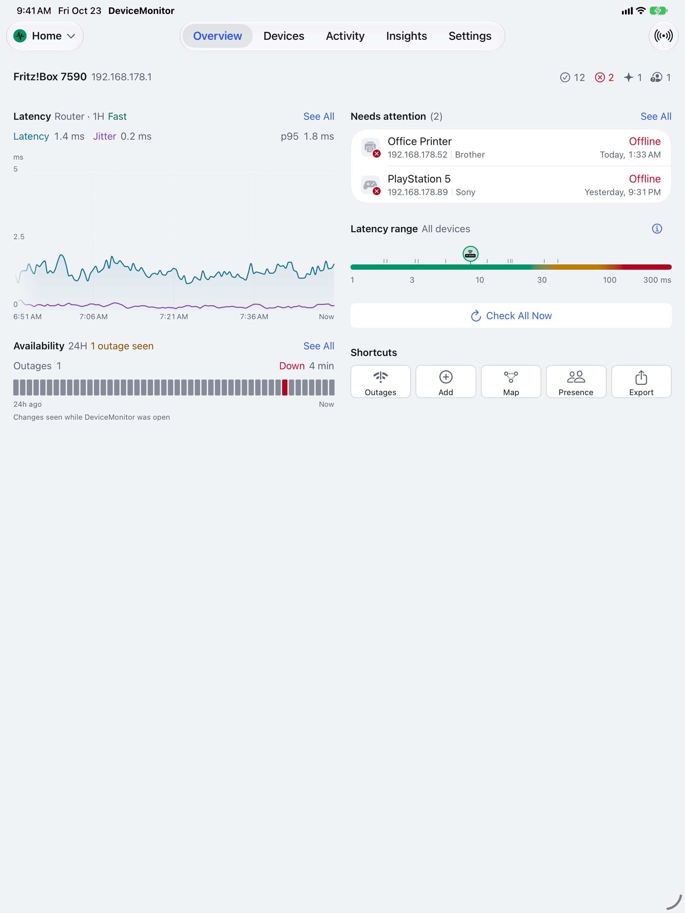
  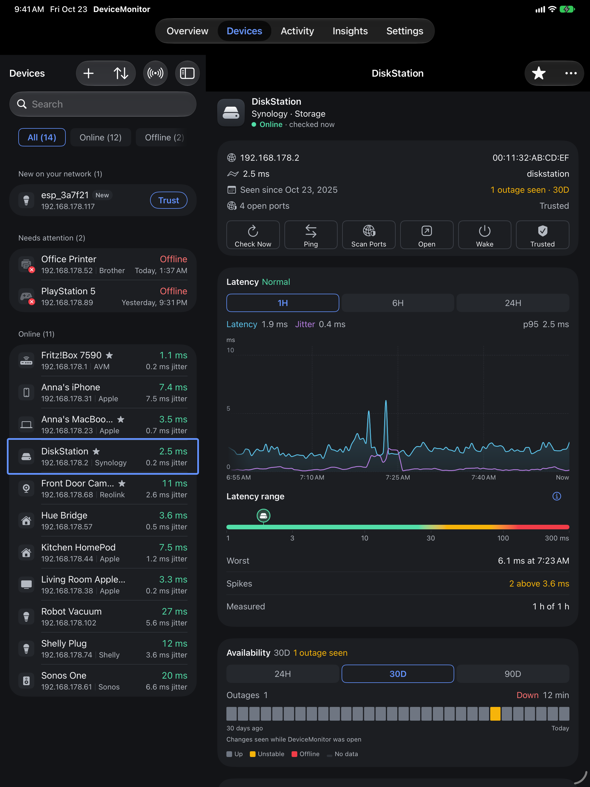
</p>

## What an iPhone app cannot do, and what DeviceMonitor does instead

| Limitation | Why | Instead |
| --- | --- | --- |
| Monitor in the background or alert when closed | iOS suspends apps; there is no entitlement for continuous LAN scanning | Monitoring runs while the app is open; Activity shows what changed, and history counts only the outages the app saw |
| Read MAC addresses (ARP) | Needs a restricted entitlement | Vendor and kind come from Bonjour, hostnames and ports; MACs from AirPlay names or typed in Edit |
| Broadcast or multicast (SSDP, mDNS wildcard, WoL broadcast) | Needs the multicast entitlement | Declared Bonjour types and unicast probes only; unicast Wake‑on‑LAN |
| Scan networks larger than /22 | Too slow and too costly for a phone | Add important devices by address |
| Ask whether Local Network access was granted | iOS has no API for it | Denial is detected from path and browser errors, and a card links to Settings |

## Architecture

```
DeviceMonitor/
  App/            App entry, AppEnvironment (composition root), router, launch arguments, menu commands
  Core/
    Contracts/    Sendable value types, errors, logging categories
    Logic/        Pure, unit-tested algorithms: reachability hysteresis, scheduling, latency
                  statistics (median, jitter, percentiles), identity, classification, security
                  score, timeline and outage detection, activity density, ICMP, Wake-on-LAN, map layout
    Persistence/  SwiftData SchemaV1 (1.0 store) -> SchemaV2 lightweight migration, store, directory
  Presentation/   Pure, unit-tested screen logic: chart series and axes, the latency range, row and
                  info-grid facts, Overview counters and attention, monitor status, latency quality,
                  uptime cells, presence grid, journal, scan stages and summary
  Networking/     TCP / ICMP / UDP probes, Bonjour browser, path observer, subnet and port
                  scanners, monitor engine (actor), permission trigger, demo network
  DesignSystem/   Tokens, components, controls (segments, chips, tiles, counters), device thumbnails,
                  layout helpers, motion, haptics
  Graphics/       The Ping D mark, the area chart, gradient scale, uptime strips, heatmap, network map,
                  scan radar, and the Metal address map and radar glow (Shaders.metal)
  Features/       Root, Overview, Dashboard, DeviceDetail, AddDevice, Scan, Timeline (Activity), Insights,
                  Settings, Onboarding, Export, Intelligence, Intents
DeviceMonitorTests/     Swift Testing suites for logic, presentation, design tokens, filters and routing,
                        persistence, migration, engine, demo data and export
DeviceMonitorUITests/   Flow tests for every main feature and light / dark screenshot capture
Docs/                   App Store listing and privacy policy
```

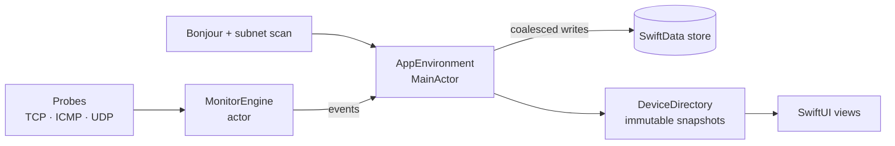

- **Strict Swift 6 concurrency** with default MainActor isolation. Networking lives in actors; everything that crosses an actor is a `Sendable` value type, and pure logic is `nonisolated` so tests call it directly.
- **One decision point for monitoring.** Network path, scene phase, the pause button and settings all feed one rule; ordered generations stop late messages from undoing newer ones.
- **Views never touch SwiftData.** They read immutable `DeviceSnapshot` values; engine events are coalesced and written every 500 ms.
- **Bounded storage**: events only on transitions, latency at most every 10 s, per‑device caps and pruning.
- **Safe upgrades**: the 1.0 store is reproduced as `SchemaV1` and migrated with `originalName`; a corrupt store is backed up, and a temporarily unavailable one (full disk, locked file) is left untouched.

## Build and run

Requirements: Xcode 27.1 or later on an Apple silicon Mac. The iPhone Duo simulator needs the iOS 27.1 runtime.

1. Open `DeviceMonitor.xcodeproj` and choose the `DeviceMonitor` scheme.
2. Pick an iPhone 18 Pro, iPad or iPhone Duo simulator, or a device, and run.
3. On a device, allow local network access when asked. The simulator shares your Mac's network.

To see the app without a network, add `-demo` to the scheme's launch arguments, or turn on **Settings › About › Use demo data** and relaunch. The demo is a home network on a FRITZ!Box (192.168.178.0/24) with 14 devices: a printer and a game console switched off, a smart plug nobody has trusted yet, and a week of daily routines, a router restart and a few Wi‑Fi drop‑outs.

## Tests and CI

`DeviceMonitorTests` (Swift Testing) runs on every push on GitHub Actions (`xcode-27` runner, Xcode 27.1, iPhone 18 Pro simulator), after a build and a launch smoke test. The unit-test host starts no monitoring, so tests never race the app.

```bash
xcodebuild build-for-testing -project DeviceMonitor.xcodeproj -scheme DeviceMonitor \
  -destination 'platform=iOS Simulator,name=iPhone 18 Pro' CODE_SIGNING_ALLOWED=NO
xcodebuild test-without-building -project DeviceMonitor.xcodeproj -scheme DeviceMonitor \
  -destination 'platform=iOS Simulator,name=iPhone 18 Pro' -only-testing:DeviceMonitorTests
```

The manual **Screenshots** job runs on an iPhone 18 Pro Max and an iPad Pro 13‑inch (M5):

- `ScreenshotTests` captures seven screens in light and dark: Overview, Devices, a device page, Activity, Insights, Settings and the Scan sheet. A screen is captured only after its accessibility identifier appears, so a wrong tab is never saved; the PNGs are committed to `Media/screenshots/`, and older captures are removed only when an appearance is complete.
- `FlowTests` then drives every main feature on demo data in seventeen tests: the Overview and its counters, attention rows and shortcuts, opening a device, Ping, Check Now, the latency window, editing a device and cancelling, Add Device validation, search, the Offline filter, Activity and the Insights sections, trusting a stranger, a full scan, Settings sub-pages and search, and changing the check interval. The tests find elements by stable identifiers such as `screen.devices` and `deviceRow.192.168.178.2`.
- The job summary lists each flow test and the placed and missing captures per device.

## App Store

The listing, review notes and screenshot sizes are in [`Docs/AppStoreListing.md`](Docs/AppStoreListing.md) and the privacy policy in [`Docs/PrivacyPolicy.md`](Docs/PrivacyPolicy.md).

- [x] Local Network purpose string with an example, and `NSBonjourServices` kept in sync by a unit test
- [x] Privacy manifest: no tracking, no collected data
- [x] Liquid Glass with no compatibility opt-out; IPv6 supported (App Review 2.5.5)
- [x] Demo data switch for App Review
- [x] Layered Icon Composer app icon with light, dark, tinted and clear appearances, rendered by CI
- [ ] Icon review in Icon Composer and at Home Screen sizes (needs a Mac)
- [ ] iPhone Duo screenshots (need the iOS 27.1 simulator runtime on a Mac)

## Privacy

No account, analytics, advertising or location. Devices, history and notes live only in the app's local store; Apple Intelligence runs on‑device; exports leave the phone only when you share them.

## Licence

MIT, see [LICENSE](LICENSE).
